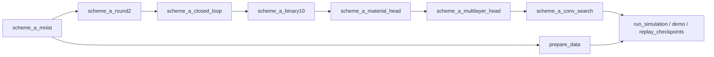

# Rewritable volumetric optical-weight simulation

A PyTorch simulation of a convolutional neural network whose weights are stored
as binary written/unwritten sites in ten depth planes of a rewritable optical
material. The network is trained on MNIST with the material treated as a
persistent device: the binary pattern is written, read back for the forward
pass, and fully erased and rewritten whenever training changes it.

The code accompanies Section 2.6 and the Supplementary Information section
**Rewritable volumetric weights for multilayer inference**. It is released under
the [MIT licence](LICENSE).

> **Scope.** This is an idealised independent-intensity-channel simulation. It
> does not model wave-optical propagation, thermal behaviour, noise or crosstalk,
> and it is not a hardware demonstration.

## Contents

- [Model overview](#model-overview)
- [Repository layout](#repository-layout)
- [Modules and implementation](#modules-and-implementation)
  - [1. Material weight model](#1-material-weight-model--scheme_a_binary10py)
  - [2. Material layers and intensity encoding](#2-material-layers-and-intensity-encoding--scheme_a_material_headpy)
  - [3. Four-bank network and device-in-the-loop training](#3-four-bank-network-and-device-in-the-loop-training--scheme_a_multilayer_headpy-scheme_a_closed_looppy)
  - [4. Configurable architecture, training and search](#4-configurable-architecture-training-and-search--scheme_a_conv_searchpy)
  - [5. Data loading and split](#5-data-loading-and-split--scheme_a_mnistpy-scheme_a_round2py-prepare_datapy)
  - [6. Command-line entry points](#6-command-line-entry-points--run_simulationpy-demopy)
  - [7. Reporting and checkpoint replay](#7-reporting-and-checkpoint-replay--supplementary_reportingpy-replay_checkpointspy)
  - [8. Tests](#8-tests--tests)
- [Installation](#installation)
- [Usage](#usage)
- [Outputs and recorded results](#outputs-and-recorded-results)
- [Limitations](#limitations)
- [Citation](#citation)

## Model overview

**Weights from binary depth sites.** Each weight is read through a positive and
a negative branch. Each branch passes through ten depth planes, each holding one
binary site $s_{l,b} \in \{0,1\}$. A written site lowers transmitted intensity
by the contrast $c = 0.1$:

$$
T_b = \prod_{l=1}^{10} \left(1 - c\, s_{l,b}\right), \qquad
w = G\,(T_+ - T_-), \qquad G = \frac{1}{1-(1-c)^{10}} \approx 1.535 .
$$

The gain $G$ keeps every weight in $[-1, 1]$. Because transmission depends only
on how many sites are written, each branch has eleven levels.

**Network.** The selected architecture `c12_k5_s1` has four material weight
banks that share the same ten depth planes:

| Stage | Operation | Bank shape `(planes, branches, out, in)` | Binary sites |
| --- | --- | --- | ---: |
| Input | 28 x 28 MNIST image, area-downsampled to 14 x 14 | - | - |
| `conv` | 12 kernels, 5 x 5, stride 1 → 12 x 10 x 10, ReLU, adaptive average pool to 3 x 3 | `(10, 2, 12, 25)` | 6,000 |
| `fc1` | 108 → 32, ReLU | `(10, 2, 32, 108)` | 69,120 |
| `fc2` | 32 → 16, ReLU | `(10, 2, 16, 32)` | 10,240 |
| `fc3` | 16 → 10 logits | `(10, 2, 10, 16)` | 3,200 |
| **Total** | 4,428 signed weights, 70 electronic biases | | **88,560** |

Only the weighted sums use the material. Bias, ReLU, pooling, differential
subtraction and intensity re-encoding are electronic.

**Training.** A real-valued latent variable per site is thresholded to an exact
binary value in the forward pass and trained with a sigmoid straight-through
gradient. Logits are computed from the pattern currently written in the
simulated device. After each optimizer step the new pattern is programmed; if
any site changed, all four banks are erased and rewritten.

## Repository layout

```text
.
├── demo.py                      # synthetic end-to-end check, no download
├── run_simulation.py            # train and test the selected model
├── prepare_data.py              # MNIST download + fixed split
├── scheme_a_binary10.py         # material weight model, binary STE
├── scheme_a_material_head.py    # material layers, intensity encoding
├── scheme_a_multilayer_head.py  # four-bank model and device
├── scheme_a_conv_search.py      # configurable architecture, training loop, search
├── scheme_a_closed_loop.py      # device/proxy gradient bridge, helpers
├── scheme_a_mnist.py            # checksum-verified MNIST loader
├── scheme_a_round2.py           # 14 x 14 patch extraction helper
├── reproduce.py                 # small numeric utilities
├── supplementary_reporting.py   # validate source tables, draw Supp. Figs. 12/13
├── replay_checkpoints.py        # exact replay of archived checkpoints
├── requirements.txt
├── requirements-reporting.txt
├── tests/                       # unit and regression tests
└── docs/
    ├── REPRODUCIBILITY.md                  # full protocol and equation-to-code map
    ├── SUPPLEMENTARY_REVISION_20261004.md  # reporting and replay guide
    └── manuscript_figure_map.json          # figure file names used in the manuscript
```

The `scheme_a_*` module names are kept so that archived checkpoints, source
hashes and imports remain compatible. Modules build on each other in this
order:



## Modules and implementation

### 1. Material weight model — `scheme_a_binary10.py`

Defines the physical assumptions and the binary-to-weight mapping used by every
later module.

| Name | Implementation |
| --- | --- |
| `Config` | Frozen dataclass: `layers=10`, `layer_intensity_contrast=0.10`, write/read wavelengths 976/418 nm, 50 µm spot and pitch. Crosstalk and noise fields must be zero. Properties: `shape = (10, 2, 3, 9)`, `minimum_transmission = 0.9**10`, `gain = 1 / (1 - 0.9**10)`. |
| `binary_ste(theta)` | Forward value `(theta >= 0)`; gradient of `sigmoid(theta)`. The forward pass is exactly binary. |
| `transmissions(bits, config)` | Product over planes of `1 - 0.1 * bits`, giving one transmission per branch. |
| `weights(bits, config)` | `gain * (T[0] - T[1])`, the signed differential weight. |
| `Model`, `Device`, `train`, `main` | A single material convolution with an electronic linear head, compared across three arms (`binary_offline`, `frozen_binary`, `binary_closed_loop`). Kept as an earlier stage of the study; `main` writes to its own output folder. |

### 2. Material layers and intensity encoding — `scheme_a_material_head.py`

Moves the classifier into the material and adds the electronic interface between
layers.

| Name | Implementation |
| --- | --- |
| `optical_weights(bits, config)` | Same transmission product and differential weight as above, for any bank shape. |
| `encode_features(h)` | Divides each sample by `max(1, max(h))` so inputs are valid relative intensities in `[0, 1]`; returns the scale. |
| `material_classifier(h, w, bias)` | `(encode(h) @ w.T) * scale + bias`: material weighted sum, then electronic rescaling and bias. |
| `feature_vector(x, w, bias)` | 3-kernel 3 x 3 convolution as a matrix product over patches, ReLU, 4 x 4 average pool → 27 features. |
| `evaluate(model, x, y, device=None)` | Batched argmax accuracy using either the proxy weights or the weights read from the device state. |
| `Device.program(target)` | Accepts exact binary masks for every bank; erases all banks before writing any; skips programming when the mask is unchanged; counts erase and write events. |
| `Model`, `train`, `main` | Material convolution + 27 → 10 material head, compared across three arms. Earlier stage of the study. |

### 3. Four-bank network and device-in-the-loop training — `scheme_a_multilayer_head.py`, `scheme_a_closed_loop.py`

| Name | Implementation |
| --- | --- |
| `ZONES` | The four banks: `conv`, `fc1`, `fc2`, `fc3`. |
| `Model` | One latent tensor `<zone>_theta` per bank, initialised from `N(0, 0.5²)` with seeds `seed + 1000/4000/5000/6000`. Biases: zero for the convolution, uniform `±1/sqrt(fan_in)` for dense layers. `bits()` thresholds the latents; `weights()` maps them through `binary_ste` and `optical_weights`. |
| `Device` | Holds the written state of all four banks as buffers. `program()` rewrites all four atomically. |
| `training_logits(model, device, x)` | Uses `surrogate_bridge` per bank: forward values from the device, gradients from the proxy. |
| `surrogate_bridge(observed, proxy)` | `observed.detach() + (proxy - proxy.detach())` (in `scheme_a_closed_loop.py`). |
| `mask_rows`, `export_mask` | Lay every site out on a lateral grid at 50 µm pitch per depth plane and write a CSV of `(layer, zone, branch, x_um, y_um, write_bit)`. |
| `train`, `main` | Fixed 3-kernel version with dense widths 27 → 32 → 16 → 10, compared with the single material head. Earlier stage of the study. |

`scheme_a_closed_loop.py` also provides `save_json` and `hash_file`, used for
run records and source hashing.

### 4. Configurable architecture, training and search — `scheme_a_conv_search.py`

The module used by the selected model and the architecture search. It reuses
`weights`, `forward` and `training_logits` from module 3 and generalises the
convolution.

| Name | Implementation |
| --- | --- |
| `Architecture(channels, kernel, stride)` | Kernel 3 or 5, stride 1 or 2. Derived `side = (14 - kernel) // stride + 1`, dense widths `(9 * channels, 32, 16, 10)` and name such as `c12_k5_s1`. |
| `GRID` | The 12 searched architectures: channels 3/6/12 × kernel 3/5 × stride 1/2. |
| `patches(images, arch)` | Scales pixels to `[0, 1]`, area-downsamples to 14 x 14 and unfolds into convolution windows. |
| `shapes`, `resources` | Bank shapes and counts of binary sites, signed weights, electronic biases and channel readings per image. |
| `Model.logits_from_weights` | Convolution as `patches @ w_conv.T`, bias, ReLU, adaptive average pool to 3 x 3, then three `material_classifier` layers with ReLU between them. |
| `Device` | Four-bank device sized for the given architecture. |
| `train(config, arch, seed, ...)` | Adam over the latents and biases; minibatch order from `seed + 3000`. After every step: `device.program(model.bits())`. Validation after each epoch from the device state; keeps the earliest best epoch. Saves `<name>.pt`, `_history.json`, `_events.json`, `_result.json`; a finished `_result.json` is reused on resume. |
| `load_selected(path)` | Rebuilds model and device from a checkpoint and checks the stored bits match. |
| `summarize` | Ranks architectures by mean validation accuracy, then fewer sites, then name. |
| `main` | Runs 36 search fits (12 architectures × seeds 0/1/2), locks the winner, retrains it and the `c3_k3_s1` reference with seeds 3/4/5, then tests both and writes write-mask CSVs. Records source hashes so `--resume` refuses changed code. |

### 5. Data loading and split — `scheme_a_mnist.py`, `scheme_a_round2.py`, `prepare_data.py`

| Name | Implementation |
| --- | --- |
| `fetch_data(folder)` | Downloads the four MNIST IDX archives from the PyTorch mirror if missing, checks MD5, records SHA-256 and parses images and labels. |
| `make_split(labels)` | Stratified `train_test_split` of the 60,000 training images with `random_state=202609`: 50,000 train, 10,000 validation; the 10,000 official test images form the test set. |
| `prepare(data_dir, split_path)` | Loads data, builds the split and saves it, or raises if an existing split file differs. |
| `scheme_a_round2.patches(images, size)` | Fixed 3 x 3 patch extraction used by the earlier-stage modules. |

### 6. Command-line entry points — `run_simulation.py`, `demo.py`

- **`run_simulation.py`** trains the fixed `c12_k5_s1` model with seeds 3/4/5
  (20 epochs, batch 512, Adam, learning rate 0.005, 4 CPU threads, deterministic
  algorithms). It writes a run plan with data and source hashes, trains each
  seed with `train` from module 4, fixes all checkpoints before touching the test
  set, then tests each one. It checks that device and proxy predictions are
  identical and reports accuracy, macro-F1 and resources.
- **`demo.py`** builds the same model on 16 synthetic images, takes one
  optimizer step and asserts that all four banks get finite nonzero gradients,
  that proxy and device logits are identical, that a reset clears all written
  sites and that an unchanged mask skips programming.

### 7. Reporting and checkpoint replay — `supplementary_reporting.py`, `replay_checkpoints.py`

| Name | Implementation |
| --- | --- |
| `load_tables(source, required_files)` | Reads Supplementary Data 1 (ZIP or folder). Requires one manifest entry per file, rejects duplicates and unsafe paths, and checks SHA-256 and byte size. |
| `classification_metrics` | Accuracy, macro-F1 and confusion matrix from labels and predictions. |
| `validate_tables(tables)` | Recomputes all six confirmation metrics from per-image predictions; checks the mean confusion matrix, class counts, earliest-best epochs, 1,961 resets per run, 36 search fits, ranking order, resource totals and the depth encoding table. |
| `plot_figures` | Draws Supplementary Fig. 12 (branch transmission levels, differential weight map) and Fig. 13 (validation ranking, paired confirmation, training loss, mean confusion matrix) as PNG, SVG, PDF and TIFF. |
| `replay_checkpoints.main` | Checks the split and data hashes against the archive, loads the six archived checkpoints, re-evaluates them on MNIST and asserts the predictions equal the archived arrays exactly. |

### 8. Tests — `tests/`

| File | Covers |
| --- | --- |
| `test_binary10.py` | Transmission levels, weight range, binary STE gradients, full erase/rewrite, persistent device state, short train/reload |
| `test_material_head.py` | Intensity encoding, explicit channel products, atomic two-bank rewrite, mask positions, pitch metadata, train/reload |
| `test_multilayer_head.py` | Site budget, explicit forward pass, gradients in all four banks, invalid masks, unique layout, train/reload |
| `test_conv_search.py` | Patch unfolding vs. explicit convolution, all 12 architectures, atomic rewrite, train/select/reload and resume |
| `test_entrypoints.py` | Fixed split, rejection of a mismatched split, `run_simulation` on synthetic data |
| `test_supplementary_reporting.py` | Metrics, manifest and hash checks, rejection of corrupted, incomplete or duplicated archives |

The tests use synthetic data and need no network access.

## Installation

Tested on Windows with Python 3.13.5, PyTorch 2.10.0 (CPU), NumPy 2.1.3 and
scikit-learn 1.6.1. No GPU is needed.

```bash
git clone https://github.com/jinglinxin11/rewritable-volumetric-optical-simulation.git
cd rewritable-volumetric-optical-simulation
python -m venv .venv
```

Activate the environment (`.venv\Scripts\Activate.ps1` in PowerShell, or
`source .venv/bin/activate`), then install:

```bash
python -m pip install torch==2.10.0 --index-url https://download.pytorch.org/whl/cpu
python -m pip install -r requirements.txt
```

Figure regeneration also needs `python -m pip install -r requirements-reporting.txt`.

## Usage

Run all commands from the repository root. Every command refuses to write into
an existing output directory.

**Quick check** (a few seconds on a CPU):

```bash
python demo.py
python -m unittest discover -s tests -p "test_*.py" -v
```

**Train the selected model:**

```bash
python run_simulation.py --output outputs/selected_model
```

Options: `--epochs`, `--seeds`, `--batch-size`, `--lr`, `--data-dir`. For a
short software check: `--epochs 1 --seeds 3`.

**Run the architecture search:**

```bash
python prepare_data.py
python scheme_a_conv_search.py --output outputs/architecture_search
```

Add `--resume` to continue an interrupted search in the same directory.

**Regenerate Supplementary Figs. 12/13 and Tables 6/7** from Supplementary Data 1:

```bash
python supplementary_reporting.py --data Supplementary_Data_1.zip --output outputs/supplementary_figures
```

**Replay the archived checkpoints:**

```bash
python replay_checkpoints.py --archive path/to/extracted_data --data-dir data/MNIST/raw --output outputs/archived_replay
```

## Outputs and recorded results

A training run writes the run plan, the data split, per-seed histories, device
event logs, checkpoints (`*.pt`), test predictions and confusion matrices
(`*_test.npz`), and `test_summary.json`. See
[docs/REPRODUCIBILITY.md](docs/REPRODUCIBILITY.md#output-definitions-and-expected-results)
for every file and field.

The archived study run gave:

| Model | Test accuracy, seeds 3 / 4 / 5 | Mean ± population SD |
| --- | --- | --- |
| `c12_k5_s1` (selected) | 97.45%, 98.05%, 98.03% | 97.84% ± 0.28 pp |
| `c3_k3_s1` (reference) | 94.35%, 94.63%, 94.53% | 94.50% |

Each selected-model run recorded 1,961 reset events: one initial write plus a
rewrite after each of the 20 × 98 optimizer steps. New runs are not forced to
match these numbers; floating-point and platform differences can change
training trajectories.

MNIST is downloaded on demand and not stored in the repository. Checkpoints,
numerical source data and figure exports are distributed as
[release assets](https://github.com/jinglinxin11/rewritable-volumetric-optical-simulation/releases/tag/v1.1.0)
and as **Supplementary Data 1** with the paper.

## Limitations

- Ideal intensity channels with zero noise and zero crosstalk.
- The surrogate gradient is a training method, not a model of physical switching.
- Reset counts are simulator events, not measured thermal cycling or endurance.
- The official MNIST test set was used in earlier project analyses, so it is not
  a fresh blind test.
- Tested only on Windows; Linux and macOS have not been checked.

## Citation

Please cite the versioned release rather than an unspecified commit:

> jinglinxin11. *Rewritable volumetric optical-weight simulation*, version 1.1.0.
> GitHub (2026).
> https://github.com/jinglinxin11/rewritable-volumetric-optical-simulation/releases/tag/v1.1.0

No DOI has been assigned.
